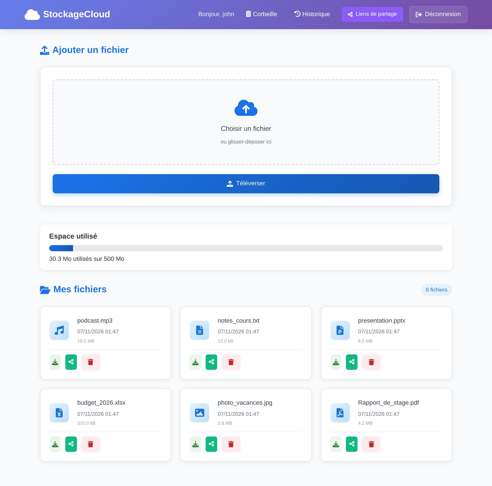
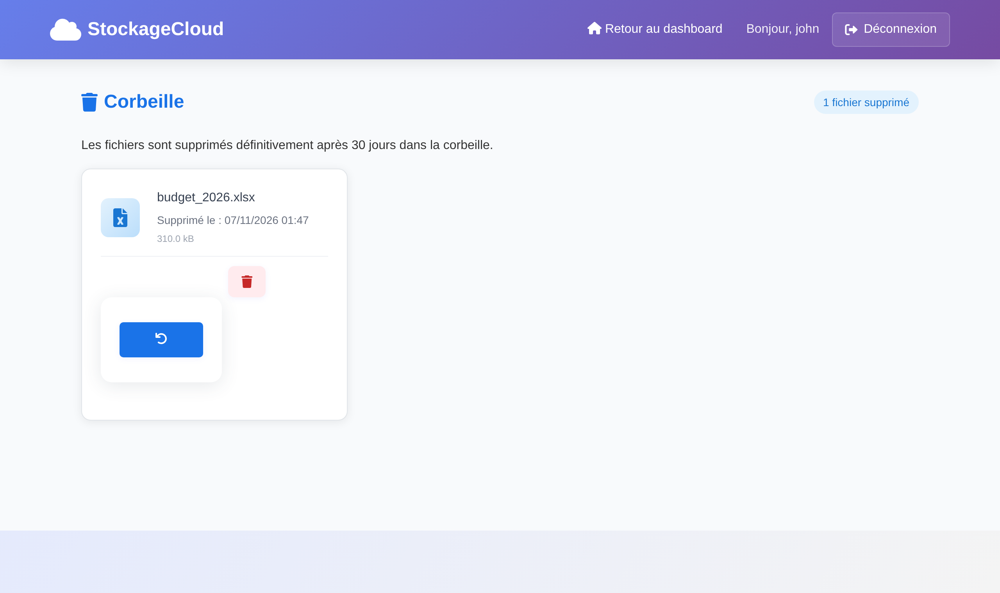
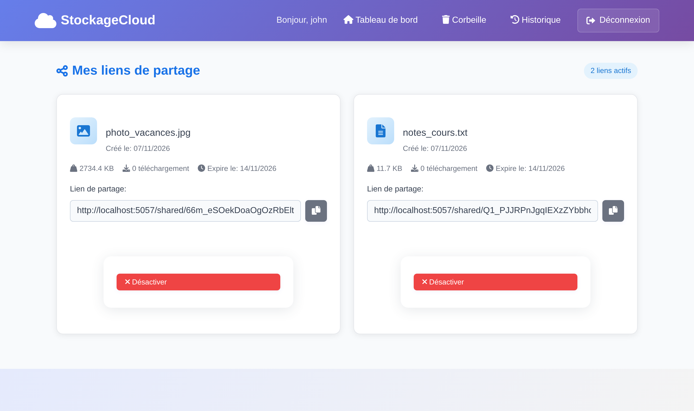

# StockageCloud — encrypted personal cloud storage


A self-hostable file storage web app written in Python/Flask, built with a security-first design:
every file is **encrypted at rest with AES-256-GCM**, integrity-checked on every download, and
shared only through expiring, revocable links.

**Live demo:** [johnm123.pythonanywhere.com](https://johnm123.pythonanywhere.com/mainpage) (free hosting, so the demo data may be reset; don't upload anything personal).

I started it in 2025 as a summer project in place of an internship and later hardened it
(encryption, CSRF protection, brute-force throttling, a test suite, Docker and CI).



## Features

| | |
|---|---|
| **Accounts** | Registration with password policy, salted password hashing (Werkzeug scrypt), 8-hour sessions |
| **Files** | Upload / download / drag-and-drop, 50 MB per file, 500 MB quota per user |
| **Trash** | Soft delete with restore; files are purged automatically after 30 days |
| **Sharing** | One-click share links (256-bit random tokens) that expire after 7 days, can be revoked, and count downloads |
| **History** | Per-user activity log (upload, download, delete, restore, share) |

| Trash | Share links |
|---|---|
|  |  |

## Security design

| Threat | Mitigation |
|---|---|
| Someone copies the `uploads/` folder or a backup | **Envelope encryption**: each file is encrypted with its own random 256-bit key (AES-256-GCM); that key is itself encrypted with a server master key kept outside the database ([`crypto.py`](crypto.py)) |
| A stored file is modified or corrupted | GCM authentication tag + SHA-256 checksum verified on every download; tampered files are refused |
| Ciphertext swapped between two file records | The file's storage ID is bound as GCM associated data |
| Password guessing | Account + IP lockout after repeated failures (5 per user / 20 per IP in 15 min) |
| Cross-site request forgery | Per-session CSRF token required on every POST (form field or `X-CSRFToken` header) |
| Accessing another user's files (IDOR) | Every query is scoped to the logged-in user; covered by tests |
| Session hijacking / fixation | HttpOnly + SameSite cookies, `Secure` in production, session regenerated at login |
| Clickjacking, MIME sniffing, XSS | `Content-Security-Policy`, `X-Frame-Options: DENY`, `X-Content-Type-Options: nosniff`, Jinja auto-escaping |
| Malicious uploads | Extension allow-list, `secure_filename`, files stored under random UUIDs with no extension and never served directly |
| Leaked secrets | No secrets in code: `SECRET_KEY` and `MASTER_KEY` come from the environment |

## Quick start

```bash
git clone https://github.com/JMJJ-projects/StockageCloud.git
cd StockageCloud
python -m venv venv && source venv/bin/activate   # Windows: venv\Scripts\activate
pip install -r requirements-dev.txt

flask --app app gen-keys > .env        # then export the two values (see below)
flask --app app init-db
flask --app app run
```

Set the keys as environment variables before running (`export $(cat .env | xargs)` on Linux/macOS).
Without them the app still starts but generates throwaway keys, so stored files become unreadable
after a restart.

### With Docker

```bash
flask --app app gen-keys > .env   # or copy .env.example and fill it in
docker compose up --build         # http://localhost:8000
```

Data (database + encrypted files) lives in the `stockage-data` volume.

## Tests

```bash
pytest -q
```

25 tests cover authentication and lockout, CSRF, encryption at rest, tamper detection,
cross-user access, quotas, trash retention and share-link expiry/revocation. They run on
every push via GitHub Actions (Python 3.10 and 3.12).

## Project structure

```
app.py          Flask app factory and routes
crypto.py       AES-256-GCM envelope encryption
security.py     CSRF, login throttling, password policy, HTTP security headers
db.py           SQLite connection helpers + `init-db` command
schema.sql      Database schema
templates/      Jinja templates (UI in French)
static/         CSS and JavaScript
tests/          pytest suite
```

## Possible next steps

- Master-key rotation command (re-wrap the per-file keys)
- Streaming encryption for files larger than memory
- Two-factor authentication (TOTP)
- Password-protected share links

---
Author: **John-Michael JENY JEYARAJ** · [Portfolio](https://jmjjprojects.com) · [LinkedIn](https://www.linkedin.com/in/jmjj/)
